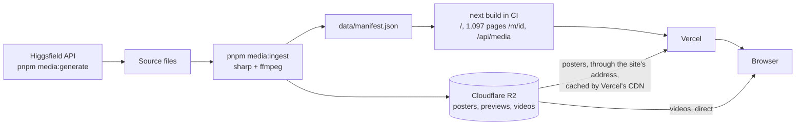

# Generation Feed

A gallery of 1,097 AI-generated images and short videos that opens fast, never jumps, and
plays a video preview the moment you hover, even on a mid-range phone.

**Live:** https://generation-feed.vercel.app (add [`?perf=1`](https://generation-feed.vercel.app/?perf=1)
for live performance numbers)

**LCP 2.3 s** on a mid-range phone over slow 4G · **at most 6 live videos** for 1,097 items ·
**zero layout shift**

<sub>Lighthouse mobile on the live site, median of 5 runs (score 96, CLS 0.000). Live videos:
`<video>` elements in the page at any moment, however fast you hover; 2 on phones.</sub>

> Independent project, not affiliated with Higgsfield. Media generated with Higgsfield's
> public API and labeled AI-generated.

## The problem

A feed for an AI video product shows thousands of images and clips. Built the obvious way,
it's slow and heavy in three places:

- **The first screen waits for JavaScript.** A masonry grid needs the screen's width, so the
  cards usually appear only after the page's scripts have run. On a phone over a slow
  network that's seconds of empty page, and the largest image, which is what LCP measures,
  comes last.
- **Every video card holds a video.** One `<video>` per card means a buffer, and often a
  hardware decoder, for each video card on screen. Scrolling and hovering pile them up.
- **Fixing the first screen risks a jump.** The server doesn't know the screen's width. If
  it places the cards one way and the browser another, everything moves once the scripts
  run.

The first, naive version (kept as the git tag `v0.2-naive`) had the first two: Lighthouse LCP 4.28 s, and up to 9
live videos on a desktop screen.

## The approach

- **Every file is made ahead of time.** A local pipeline encodes each image as AVIF and WebP
  at six widths (320–1920 px), each clip as a 2.5 s preview and a full MP4, and each item as
  a ThumbHash: a blurred preview in about 21 bytes. Every file gets an address that never
  changes, so browsers and CDNs keep it for a year.
- **The server renders the first screen, and CSS places it.** The first 40 cards are in the
  HTML, positioned by container queries with the same math the browser uses later. The page
  paints before any JavaScript, and nothing moves when the scripts take over.
- **Six videos are shared by every card.** A card borrows a `<video>` while it should play
  and gives it back after. When all six are busy, the one used longest ago is emptied, which
  frees its decoder, and lent to the new card.
- **Every goal has a number and a check:** Lighthouse CI after each deploy, end-to-end
  tests that count cards and videos in the page, a scroll-and-hover benchmark, and Vercel
  Speed Insights for real visitors.

Everything runs on free plans: Vercel, Cloudflare R2 and GitHub Actions.

## Architecture



In the browser:

| Piece | File | Job |
| --- | --- | --- |
| First page | `app/page.tsx` | Static HTML with the first 40 cards; preloads the poster most likely to be the LCP |
| Feed | `components/feed/Feed.tsx` | Loads more pages from `/api/media`; filters live in the URL |
| Grid | `components/ui/media-grid/`, `lib/masonry-layout.ts` | Masonry placement; keeps only the cards within about a screen of the viewport |
| Card | `components/ui/media-card/`, `components/feed/feed-cards.tsx` | `<picture>` with AVIF/WebP `srcset`, placeholder, hover intent, play button; the feed's names, URLs and badges |
| Video pool | `lib/video-pool.ts`, `hooks/use-video-pool.ts` | The six shared `<video>` elements, made right after hydration |

The grid, the card and the video pool began here and moved to
[Genframe](https://agzhxx.github.io/genframe/), a component kit for AI image and video tools; the
feed installs them back from its registry with `shadcn add` (`components.json`).
| Detail | `components/detail/` | A native `<dialog>` that the card zooms into (View Transitions); `/m/<id>` pages for direct links |

## Three key decisions

### 1. CSS places the first screen, not JavaScript

The placement can't depend on the screen's width, because the server doesn't know it. So each
card goes into the lane with the smallest **sum of aspect ratios** (height ÷ width): that gives
the same lanes at every width. Each server card carries its position for 2, 3, 4 and 5 lanes
as CSS custom properties. Container queries pick the set that fits, and compute the box in
`cqw` with the same formula as the browser's `cardBox()`. An end-to-end test loads the page
with JavaScript off and on, at four widths, and checks that every card lands within 0.5 px.

- **Rejected:** placing cards only in the browser (cards waited for the scripts: LCP 4.28 s),
  and TanStack Virtual, whose lanes depend on pixel heights including the gaps, so they could
  disagree with the server's and make the page jump. The grid's own virtualization is about
  60 lines.
- **Result:** Lighthouse LCP 4.28 → 3.19 s in that step, CLS 0, and the feed works without
  JavaScript (the cards are links).

### 2. A pool of six video elements

At most six `<video>` elements ever exist (two on phones and low-memory devices).

- **Borrow and return:** `acquire()` moves a video into the card and plays it. `release()`
  pauses it but keeps its source, so hovering the same card again starts at once.
- **Stealing:** when all six are taken, the least recently used one is stolen: an idle one if
  there is any, otherwise one that's still playing (its card gets told). Before lending it
  out, the pool pauses it, removes its source and calls `load()`, so the browser frees the
  decoder.
- **No flash:** the poster stays on top until the video has painted a frame
  (`requestVideoFrameCallback`).
- **Refusals:** a hidden tab pauses everything. If the browser refuses to play, as Safari
  does in Low Power Mode, the card shows a play button. The user's first click also unlocks
  all six videos for Safari.
- **Rejected:** one `<video>` per card with `preload="metadata"`, the naive version. Its
  count grows with the screen size and the share of videos.
- **The price, measured below:** the first hover on a card now waits for the network, and a
  hovered card downloads its whole preview.

### 3. Every image size is made once, in advance, and its address never changes

Before anything goes live, a script turns each picture into ready files: up to six sizes,
each as AVIF and as WebP, and each clip into a short preview and a full video. Cards use plain
`<picture>` with `srcset` and `sizes`, so every browser downloads the one size that fits its
screen. Nothing is resized while a visitor waits.

Each file's address looks like `m/<id>/v<N>/640.avif`. The `id` is a fingerprint of the
original file (50 bits of its SHA-256), and `N` is the version of the encoding settings.
Change the picture or the settings, and the file gets a new address, so an address never
points to different bytes. That's what makes it safe to serve every file with
`Cache-Control: public, max-age=31536000, immutable`: browsers and CDNs keep it for a year
and never ask whether it changed.

- **Rejected:** resizing images on request (Vercel Image Optimization, Cloudflare Images). At
  this volume, 11,210 poster files, it would cost money, and the first visitor to ask for each
  size waits while it's made.
- **Result:** posters are plain static files that any CDN can cache, and a returning visitor's
  images load straight from their own browser cache.

## Before and after

### Video previews: naive vs pooled

`pnpm bench` on the live site with the test media: 1440 × 900, empty cache, 3 runs. It
scrolls the whole feed, then hovers video cards 50 times.

| | Naive version | Pooled |
| --- | --- | --- |
| Most `<video>` elements in the page at once | 9 | **5** (never more than 6) |
| Most cards in the page at once | 70 | **51** |
| JS heap after garbage collection (scroll / hovers) | 6.0 / 5.7 MB | 5.8 / 5.6 MB |
| Hover → first video frame, p50 / p95 | 131 / 149 ms | 298 / 415 ms |
| Bytes downloaded (all / media) | 2.1 / 1.9 MB | 7.2 / 6.9 MB |

The pool caps the videos by design: 9 grows with the screen, 6 never does. The last two rows
are its price. In the naive version every video in the page had already loaded its metadata
before you hovered; the pool downloads nothing until a card asks, then loads the whole
preview (at most 226 KB).
Hover → first frame still meets the 300 ms aim at p50. The heap barely changes, because video
buffers live outside it. Part of the drop in cards comes from the grid's own virtualization.

### Lighthouse on the live site

Lighthouse CI after each deploy (mobile: a mid-range phone, slow 4G, 4× slower CPU), median of
5 runs, before and after a round of performance tuning.

| | Before tuning | After tuning |
| --- | --- | --- |
| Performance score | 78 | **96** |
| LCP | 4.91 s | **2.26 s** |
| First paint (FCP) | 1.83 s | **1.07 s** |
| CLS | 0.000 | 0.000 |
| TBT | 34 ms | 71–283 ms |
| First-load JS | 163.0 KB gzip | 163.2 KB gzip (budget 172.3) |

- **Posters now come from the site's own address.** Vercel fetches them from R2 and caches
  them near the visitor. The browser skips a second connection to R2's development address,
  which is rate-limited and has no edge cache. This is what moved LCP.
- **Less work at start-up:** no `Intl` formatting (the first call loads the browser's locale
  data, about 45 ms on a 4× slower CPU), no ThumbHash decoding for the 40 cards already in the
  HTML (about 30 ms), and the page's own work after hydration down from two long tasks to one
  short one: the switch to pixel layout runs as a React transition, and the video pool no
  longer forces a re-render of the whole feed.
- **TBT is set by the framework.** Lighthouse counts blocking time only after the first paint.
  Before tuning, the paint came late, so most of the start-up went uncounted (34 ms). Now what's
  left is Next.js and React starting up: about 200 ms of blocking on Lighthouse's mid-range
  phone, the same as for an empty Next.js page. The page's own share is a few milliseconds, so
  the CI budget is 350 ms: above the framework's floor, low enough to catch a regression. Fast
  test machines show about 70 ms, slow ones up to 283 ms.
- **LCP sits at the 2.5 s budget**, so it's a warning in CI, not an error. The first poster is
  a film-grain texture that stays 42 KB however it's encoded. Only a lower quality would
  shrink it, and that would smooth away the grain.

Every measurement, with its method, is in [docs/PERF.md](docs/PERF.md).

## Tests

- **200 unit and component tests** (Vitest and Testing Library): layout math, the video
  pool's rules (written before the pool), URL filters, the manifest's schema, cards, grid,
  header, detail view and states.
- **25 end-to-end tests in Chromium, WebKit and Firefox** (Playwright), against a production
  build with a made-up 1,000-item feed and local media. They check that:
  - scrolling 1,000 items keeps at most 150 cards in the page;
  - 30 fast hovers never create more than 6 videos;
  - the server's CSS layout matches the browser's within 0.5 px;
  - a ranged request for a poster goes to R2, so the CDN only caches whole files;
  - the detail view, filters, offline mode and phone layout work, and axe finds no serious
    accessibility issues.
- **Lighthouse CI** after every production deploy: CLS, TBT, script size and accessibility
  fail the run if they break their budgets; LCP warns.
- **Real devices:** a 10-step checklist on a Mac (Safari) and an iPhone (see "Browser
  support" below).

## Accessibility

- Every card is a link with a full label ("prompt. Video, 5 seconds, model, AI-generated.").
  The feed works by keyboard, and without JavaScript.
- The detail view is a native `<dialog>`: focus moves in, ← → browse, Esc closes, and focus
  returns to the card you ended on.
- Reduced Motion: nothing plays on its own; video cards show play buttons. Save-Data also
  halves the poster sizes the browser picks.
- One live region announces the result count when filters change.
- axe finds no serious or critical issues on the feed or in the detail view; Lighthouse
  accessibility is 100.

## When things go wrong

| What fails | What you see |
| --- | --- |
| A page of results | One quiet retry, then an inline error with Retry |
| The connection | An offline banner; loading resumes when it's back |
| A poster | Its placeholder stays, with a retry button |
| A video | The poster stays |
| The browser refuses to play (Low Power Mode, auto-play off) | A play button |
| No results | A message with Clear filters |
| An unknown `/m/<id>` | A real 404 page |
| JavaScript | The first page still shows, and every card is a working link |

## For developers

### Stack

Next.js 16 (App Router) · React 19 · TypeScript (strict) · Tailwind CSS 4 · Vitest +
Testing Library · Playwright · GitHub Actions · Vercel · Cloudflare R2 · sharp + ffmpeg

### Run it locally

Needs Node 24 (`nvm use`) and pnpm (`corepack enable`).

```bash
pnpm install
pnpm dev
```

| Command | What it does |
| --- | --- |
| `pnpm dev` | Dev server at http://localhost:3000 |
| `pnpm lint` | ESLint |
| `pnpm typecheck` | Generates route types, then runs `tsc` |
| `pnpm test` | Unit and component tests (Vitest) |
| `pnpm build` | Production build |
| `pnpm build:e2e` | Production build of the synthetic test media, for the end-to-end tests |
| `pnpm test:e2e` | End-to-end tests in Chromium, WebKit and Firefox (run `pnpm build:e2e` first) |
| `pnpm measure:js` | First-load JS in gzip bytes (run `pnpm start` first) |
| `pnpm lighthouse` | Lighthouse CI on the live site, 5 mobile runs, checked against the budgets in `lighthouserc.json`; reports in `.lighthouseci/` |
| `pnpm media:dev` | Makes 300 test images and 40 test videos in `media-src/dev/` (needs ffmpeg); `pnpm media:ingest --sources media-src/dev/sources.json --manifest data/manifest.synthetic.json` turns them into the test set |
| `pnpm media:plan` | Prints what generating the real media would cost and writes every prompt to `media-src/real/prompts.md`; spends nothing |
| `pnpm media:generate` | Generates media with the Higgsfield API: `--test`, `--second-test`, `--all`, `--collection <name>` or `--only <keys>` (`--images` keeps only images), with `--dry-run` (spends nothing) or `--max-spend <dollars>`; `--discard <keys>` rejects finished results so the next run makes them again |
| `pnpm media:sheet` | Writes a one-file review page of generated media, picked the same way, to `media-src/real/`; spends nothing |
| `pnpm media:sources` | Lists the generated media for ingest (`media-src/real/sources.json`), from the plan and the generation log |
| `pnpm media:ingest` | Encodes them into `media-out/`, writes `data/manifest.json`, uploads to R2 with each original (`--dry-run` skips the upload) |
| `pnpm r2:usage` | This month's R2 usage, compared with the free plan |
| `pnpm bench [url]` | Scroll + hover benchmark: max videos, heap, hover → first frame, bytes |

Settings: `.env` holds public values that are safe to commit, such as the media origin.
Secrets, like the R2 keys, go in `.env.local`, which is gitignored.

### Media storage

Media files live in Cloudflare R2, on its free plan. Two checks keep the project there:

- `pnpm media:ingest` checks the bucket's size and the month's uploads before it sends
  anything. It also remembers what is already uploaded, so a rerun sends no requests.
- `pnpm r2:usage` shows this month's usage for the whole Cloudflare account. The **R2 usage**
  workflow runs it every day and fails when usage gets close to the free plan's limits, and
  GitHub emails the failure. It needs two repository secrets: `CLOUDFLARE_API_TOKEN` (a token with
  Account › Account Analytics › Read) and `R2_ACCOUNT_ID`.

### Deploys

GitHub Actions deploys to Vercel once every check passes: pushes to `main` go to production,
and each pull request gets a preview link. Vercel's own Git deploys are off (`vercel.json`).
The deploy job needs a `VERCEL_TOKEN` repository secret holding a token from the Vercel
account that owns the project.

### Performance checks

- **Lighthouse CI** runs on production after every deploy (`lighthouserc.json`, also
  `pnpm lighthouse`): 5 mobile runs, median. A broken budget turns the run red:

  | Budget | Limit |
  | --- | --- |
  | CLS | ≤ 0.05 |
  | Total Blocking Time | ≤ 350 ms: Next.js and React's own start-up is about 200 ms on a mid-range phone |
  | Scripts on `/` | ≤ 172.3 KB (an empty Next.js app + 40 KB) |
  | Accessibility | ≥ 0.95 |
  | LCP | ≤ 2.5 s, a warning for now: it sits at the budget (docs/PERF.md) |

  The reports are kept for 14 days as a download on each CI run.
- **`pnpm bench [url] [--runs 3] [--hovers 50]`** scrolls the whole feed at a fixed speed,
  then hovers video cards, and reports the most live `<video>` elements at once, JS heap after
  garbage collection, hover → first frame (p50/p95) and bytes transferred. Each run starts
  with an empty cache at 1440 × 900. Run `pnpm build && pnpm start` first (or pass a URL), and
  record the results in `docs/PERF.md`.
- **Real users:** Vercel Speed Insights on production (Web Vitals at p75, mobile and desktop).

### Browser support

| Browser | How it's checked | Result |
| --- | --- | --- |
| Chrome (desktop) | e2e tests (Chromium) on every push, Lighthouse CI | Passes |
| Firefox (desktop) | e2e tests (Firefox) on every push | Passes |
| Safari (macOS) | e2e tests (WebKit) on every push; the checklist below on a real Mac | Passes. WebKit caught Safari not handing focus back after a dialog (fixed). With Safari's Auto-Play set to "Never" or in Low Power Mode, hover previews are refused and cards show play buttons instead, as designed |
| Safari (iPhone) | The checklist below on a real iPhone | The collection filter was off-screen on phones: it moved into a Filters sheet |
| Chrome (Android) | e2e tests (Chromium) on every push | Not checked on a real Android phone |

**Device checklist** (about 10 minutes per device):

1. The feed loads; pictures fade in over their colored placeholders; nothing jumps.
2. Scroll far down: no blank gaps, and scrolling stays smooth.
3. Videos: on a desktop, hovering a video card plays it; on a phone, the video card nearest
   the middle plays once scrolling stops.
4. Tap a card: the detail view opens; Copy prompt works; ← → (or the arrows) browse; closing
   returns to the same spot in the feed.
5. Filters: the type chips; on a phone, Filters → pick a collection → the results change →
   "Show N results" closes the sheet, and the button shows 1.
6. Search: type a word, then clear it.
7. Open a `/m/<id>` link directly; Back returns.
8. Go offline: a banner appears and nothing breaks.
9. Turn on Reduce Motion: no autoplay, and video cards show play icons.
10. Rotate a phone: the grid re-flows.

### Docs

- [Design](docs/design/README.md): tokens, mockup boards and the Figma steps
- [Performance log](docs/PERF.md): budgets and before/after numbers
- [Changelog](CHANGELOG.md)
